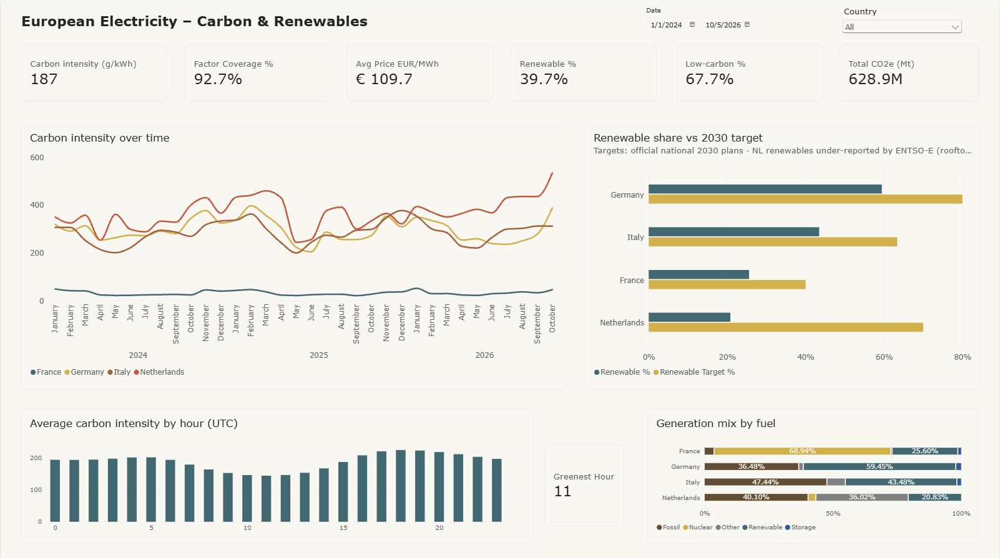
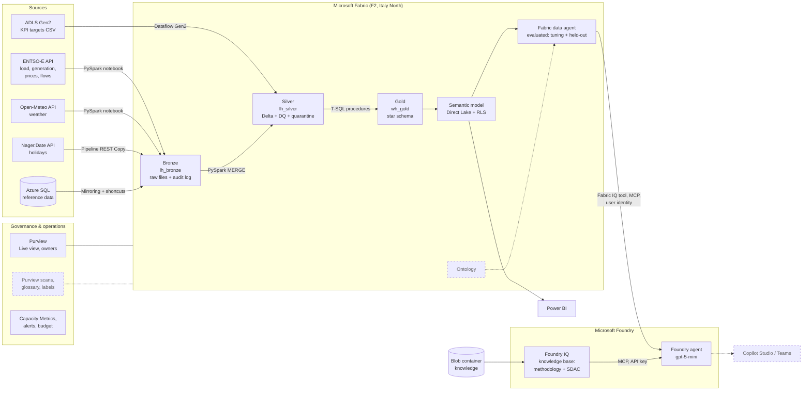

# European Energy & Carbon-Intensity Platform on Microsoft Fabric

An end-to-end data platform that answers one question: **how clean is the electricity in Europe, hour by hour, and when is the greenest time to use it?** It currently covers four markets (Italy, France, Germany, Netherlands) and is built to scale: countries, bidding zones and borders come from reference data, so adding a country is mainly a configuration change.

It combines grid data from ENTSO-E, weather from Open-Meteo, public holidays, a reference database in Azure SQL and business KPI targets into a governed medallion architecture on Microsoft Fabric. Every result is traceable from the report back to the raw API file it came from.

> **Status:** implemented and validated in a lab environment (Fabric F2): Bronze → Silver → Gold, orchestration, security, CI/CD, a Power BI Overview page, and an AI layer: a Fabric data agent benchmarked on a 21-question evaluation set and a Foundry agent checked with a 5-question regression set. Open items are listed in the [Roadmap](#roadmap).

---

## Why this project

The project started while volunteering on a sustainable farm, where I met someone running a carbon-offset project. Offsetting only makes sense when you know how much carbon your electricity actually carries, and that depends on the country, the hour and the energy mix. This platform is the data foundation for that kind of carbon insight: reliable, hourly and explainable, including where the source data is incomplete.

## Report



*Overview page (Power BI, Direct Lake): carbon intensity, renewable share vs official 2030 targets, hourly profile and generation mix for IT, FR, DE and NL.*

## Architecture



*Solid = built and tested. Dashed = recommended for production, not enabled in this lab (enterprise tier, extra licences or preview).*

| Layer | Item | What it holds |
|---|---|---|
| Bronze | `lh_bronze` | Raw XML / JSON exactly as received, audit log `ctl_ingest_log`, watermarks `ctl_watermark` |
| Silver | `lh_silver` | Cleaned, deduplicated Delta tables at source resolution, data-quality results and quarantine |
| Gold | `wh_gold` | Hourly star schema: 6 facts, 8 dimensions, run log, security objects |
| Serving | `sm_energy_sustainability` | Direct Lake semantic model with DAX measures |

## In numbers

- **~9 million** curated rows, 4 pilot countries (IT, FR, DE, NL), 10 bidding zones, 30 cross-border directions, data since 2024-01-01
- Backfill: **1,584 API chunks, none left failed in the audit log** (failed calls retried with back-off), resumable from the audit log
- Daily end-to-end run: **~27 → ~17 minutes** after optimisation (see below)
- Regression check: NL carbon intensity on 2025-06-15 = **315.7 gCO2e/kWh**, identical in Gold (T-SQL) and in the semantic model (DAX)

## Engineering decisions

**Idempotent at every layer.** Any run can be repeated without creating duplicates.
- *Bronze*: watermark per dataset and area, plus a re-pull window for late corrections. Every file is logged with status, so failed chunks are retried, not lost.
- *Silver*: dedupe by business key (latest ingest wins), then a conditional Delta `MERGE`. A state table tracks the processed point by Bronze ingest time, not by data time.
- *Gold*: transactional delete-insert over a sliding window, with a Silver-vs-Gold reconciliation gate that fails the run on mismatch (`THROW`).

**Honest carbon numbers.** Generation without a known emission factor is not treated as zero-carbon. Carbon intensity is reported together with a *factor coverage %*. Factor coverage over the full period (Oct 2026): France ~98%, Germany ~95%, Italy ~90%, Netherlands ~64%, because a large share of Dutch generation is reported under production types without an emission factor (mainly "Other"). For the Netherlands the true value may be lower or higher than reported. Definitions: [docs/Methodology.md](docs/Methodology.md).

**History where it matters.** Emission factors are an SCD Type 2 dimension, so each hour's CO2e is calculated with the factor that was valid at that time. Changing a factor does not silently rewrite the past.

**Explicit business rules** for tricky source behaviour: DE-LU publishes both 15-minute and hourly prices (official hourly price wins); flows use one resolution per border-hour to avoid double counting; the A03 curve type is forward-filled.

## Performance optimisation

| Change | Effect |
|---|---|
| Batched Open-Meteo requests (all locations per call) | 22 → 2 API calls |
| Incremental daily data-quality checks, full scan weekly, `OPTIMIZE` only above a file threshold | Less daily Spark work |
| Shared Silver helper notebook, broadcast join for small lookups | Less code, fewer shuffles |
| Shared Spark session (high concurrency) across pipeline notebooks | Fewer session start-ups |
| Diagnosed Spark throttling (error 430) and right-sized capacity | Stable runs |

Result: daily pipeline **~27 → ~17 minutes**.

## Orchestration

`pl_master` runs daily at 06:00 Europe/Rome: Bronze ENTSO-E → Bronze weather → monthly branch (holidays, KPI Dataflow) → Silver → Gold. A failure path alerts and ends in a **Fail activity**, so a handled error still marks the run as failed. Activator watches pipeline job events.

## AI layer: Fabric Data Agent with a benchmark evaluation

The Direct Lake semantic model is **prepared for AI**: business descriptions on every measure and table, a curated AI data schema (measures and descriptive attributes; keys and raw columns hidden), model-level AI instructions and verified answers ([model definition](fabric/sm_energy_sustainability.SemanticModel), [evaluation set](docs/ai-eval/questions.json)). A **Fabric Data Agent** (`da_energy_sustainability`) answers natural-language questions on carbon intensity, renewable share, prices, flows and weather, states the data period, and declines out-of-scope questions (forecasts, retail prices) instead of guessing.

**Evaluation** (`nb_80_agent_eval`, Fabric Data Agent SDK):
- Expected answers computed **live in DAX** from the same measures, so they follow each data refresh instead of going stale
- An **LLM-as-judge** with a custom rubric (±1% tolerance, equivalent units, refusal checks), published in `nb_eval_template`
- A **tuning set** (6 questions, used to improve instructions) and a **held-out set** (14 questions, never used for tuning) to avoid overfitting
- After the final change, instructions and model were **frozen** and evaluated 3 times

| | Baseline | Final (3 frozen runs) |
|---|---|---|
| Tuning | 6/6 | 18/18 (100%) |
| Held-out | 11/14 (78.6%) | **41/42 (97.6%)** |

**What the failures taught:**
- 2 of the 3 baseline failures were **semantic-model gaps**, not LLM errors: a measure without a description, and fuel groups that were never defined (the agent computed fossil share as 100% − low-carbon, counting unclassified generation as fossil).
- **Prompt wording leaks into the agent's plan:** the word "hourly" in the instructions made the agent answer daily questions with hourly breakdowns; two rules (full range vs a named period) combined into a wrong date filter.
- **A description must match what the measure returns:** a gap returned as a fraction was described as percentage points.
- Every fix was general (definitions in the model, method rules in AI instructions, scope in the agent prompt); test questions were never copied into the prompt. Each change was followed by a regression run, which caught three regressions.

**Re-evaluation after later changes** (reusable `nb_eval_template`, 3 runs, 16 Oct 2026, under capacity pressure)

| | Correct | Agent errors | Service failures (no answer) | Agent accuracy (answered) |
|---|---|---|---|---|
| Tuning | 16/18 | 1 | 1 | 16/17 (94.1%) |
| Held-out | 38/42 | 2 | 2 | 38/40 (95.0%) |
| **Total** | **54/60 (90.0%)** | **3** | **3** | **54/57 (94.7%)** |

- **Service failures** are answers the platform never produced: a generic system message after ~4–5 s, or `server_error`. They happened while the F2 capacity was throttled (`CapacityLimitExceeded`), so they are reported separately from agent errors.
- **Out-of-scope questions are the weak spot:** 5 of the 6 failures were questions the agent should decline. The most serious one presented a past value as "tomorrow's" carbon intensity.
- The judge returned "yes" for one `server_error` answer; the SDK recorded the result as unclear because the run itself failed. End-to-end results always need a check of the run status, not only the judge's verdict.

**Fix round, 17 Oct 2026** (1 run on the new version)
- **Placeholder bug, found by tracing the Foundry → data agent MCP call:** the agent copied the text "Data Through Date" from its instructions instead of querying the measure, and fell back to "2024" when unsure where the data ends.
- **Fixes:** the agent states the real end date and applies no date filter when the user gives no period; future dates ("tomorrow", forecasts) are declined explicitly.
- **Held-out caught a regression:** the first wording made the agent filter "no period" questions to 2024 (H7). Changing the method (no date filter) instead of the wording fixed it.
- The forecast question that drove the fix (H12) moved to the tuning set; a new held-out forecast question (H15) replaced it.

| | Correct | Agent errors | Service failures |
|---|---|---|---|
| Tuning (7) | 7/7 | 0 | 0 |
| Held-out (14) | 13/14 | 0 | 1 (platform message on the household-price question) |

*How to read these results: each table is a snapshot of one agent version under specific capacity conditions, and the question sets changed between rounds (H12 moved to tuning, H15 added). They show the direction of improvement on a small benchmark, not a general accuracy rate.*

**Known limitations**
- **Period label:** the agent does not always print the real end date; it sometimes writes "to the latest available date". The value and the period used are correct. A text measure with the period label would make this deterministic.
- **Future-period questions** ("tomorrow", forecasts): before the 17 Oct fix, 1 of 3 runs presented the latest historical day as a forecast. Fixed; both forecast questions passed in the following run, but one run is not proof, so this stays monitored.
- **Intermittent platform message** ("There's content here I can't work with…") on some out-of-scope questions, reproducible for the household-price question even with earlier instructions (platform-side; to be reported to Microsoft).
- **Capacity:** each evaluated question costs ~1,000 CU(s); three back-to-back runs on F2 caused throttling, which shows up as failed answers. Evaluate on a larger or paused-and-resumed capacity.
- Seasonal questions without a year ("in winter") are ambiguous: the agent sometimes uses one season instead of all, and may label the period incorrectly (1 failure in 60 answers).
- LLM answers are non-deterministic; accuracy is reported as a range over repeated runs, not a single score.
- The evaluation covers 21 questions. In production it would be extended with real user questions and monitored over time.

Row-level security in the semantic model also applies to agent users: tested with a real restricted account (workspace Viewer in role `Country_NL`), the agent returned only Netherlands values. AI usage consumes Fabric capacity (CU), so AI and ETL workloads share capacity planning.

## Security & governance

- Workspace roles and least-privilege item sharing
- **Row-level security in the semantic model** (country roles, fixed workspace identity). Warehouse RLS was removed because, even when disabled, it forced Direct Lake to fall back to DirectQuery. Column-level `DENY` and dynamic data masking remain in the Warehouse
- OneLake data access roles configured on the lakehouse
- Secrets (ENTSO-E API key) only in **Azure Key Vault**, read at runtime with `notebookutils.credentials.getSecret`, never stored in code
- Least-privilege SQL login for Fabric Mirroring

## CI/CD

- Fabric **Git integration**: the `energy-dev` workspace is synced to `main`, so every item in `fabric/` is versioned source
- **Deployment pipeline** dev → test
- Conventional commits and a [CHANGELOG](CHANGELOG.md)

## Repository structure

```
fabric/                 Fabric items synced by Git integration
  nb_1x_*               Bronze notebooks (ENTSO-E, weather)
  nb_2x_*, nb_lib_*     Silver notebooks, shared helpers, data quality
  pl_*                  Data pipelines
  df_kpi_thresholds     Dataflow Gen2
  wh_gold.Warehouse/    Gold tables, procedures, security (dim, fact, ops, sec)
azure-sql/              Reference database schema and seed data
docs/incidents.md       Real incidents and how they were solved
CHANGELOG.md
```

## Roadmap

**1. Foundation** ✅
- [x] Azure SQL reference database: countries, market areas, interconnectors, generation types with emission factors, weather points
- [x] Least-privilege SQL login for Fabric Mirroring
- [x] Fabric workspaces `energy-dev` and `energy-test`, grouped in the `Energy` domain
- [x] Git integration (`energy-dev` ↔ `main`)
- [x] Lakehouses `lh_bronze` and `lh_silver`, Spark environment with pinned libraries
- [x] Mirrored Azure SQL database exposed in Bronze through OneLake shortcuts
- [x] ENTSO-E API key stored in Azure Key Vault

**2. Bronze: raw ingestion** ✅
- [x] Audit log (`ctl_ingest_log`) and watermarks (`ctl_watermark`)
- [x] ENTSO-E notebook: load, generation, prices (10 bidding zones), cross-border flows (30 directions)
- [x] Backfill from 2024-01-01: 1,584 chunks, none left failed in the audit log, resumable
- [x] Open-Meteo weather: reanalysis archive + recent forecast
- [x] Holidays pipeline: Lookup → Filter → ForEach → REST Copy
- [x] Retries with back-off, pipeline-safe notebooks

**3. Silver: clean Delta tables** ✅
- [x] Distributed ENTSO-E XML parser on Spark (A03 forward-fill, generation vs consumption)
- [x] Dedupe + conditional `MERGE`, state table for incremental processing
- [x] Weather guard: observed values never overwritten by forecasts
- [x] Data-quality checks (uniqueness, integrity, ranges, completeness, freshness) and quarantine
- [x] `OPTIMIZE` with V-Order
- [x] KPI targets from ADLS via Dataflow Gen2

**4. Gold: star schema** ✅
- [x] `wh_gold` warehouse: 8 dimensions, 6 hourly facts (load, generation, carbon, price, flow, weather)
- [x] Transactional delete-insert procedures per fact
- [x] `ops.usp_load_gold` with a reconciliation gate and run log
- [x] SCD Type 2 emission factors, CO2e computed with the factor valid at each hour

**5. Orchestration** ✅
- [x] `pl_master`: Bronze → monthly branch → Silver → Gold, daily at 06:00 Europe/Rome
- [x] Failure path with alert and Fail activity
- [x] Activator on pipeline job events

**6. Security & governance** ✅
- [x] Workspace roles and least-privilege sharing
- [x] Row-level security, column-level security, dynamic data masking
- [x] OneLake data access roles configured

**7. CI/CD** ✅
- [x] Deployment pipeline dev → test
- [x] Conventional commits and CHANGELOG

**8. Performance** ✅
- [x] Batched weather API calls (22 → 2)
- [x] Incremental DQ checks, conditional `OPTIMIZE`
- [x] Shared helper notebook, broadcast join, shared Spark session
- [x] Daily run ~27 → ~17 minutes

**9. Real-Time Intelligence demo** ✅
- [x] Eventstream → Eventhouse with KQL window queries

**10. Reporting** 🔄 in progress
- [x] Direct Lake semantic model, star relationships, core DAX measures
- [x] Model validated against Gold (NL 2025-06-15 = 315.7)
- [x] Power BI report: Overview page (KPIs, carbon trend, renewables vs 2030 targets, hourly profile, generation mix)
- [ ] Power BI report: Market & flows and Country deep-dive pages

**11. AI layer** 🔄 in progress (Foundry ✅, Purview ✅ free tier, ontology next)
- [x] Semantic model prepared for AI (descriptions, AI data schema, AI instructions, verified answers)
- [x] Fabric Data Agent over the semantic model
- [x] Automated accuracy evaluation: held-out 78.6% → 97.6% over 3 frozen runs
- [x] Reusable evaluation template (`nb_eval_template`, question file with live truth DAX), agent vs service failures reported separately
- [x] Capacity monitoring of AI workloads (~1,000 CU(s) per evaluated question, throttling under repeated runs)
- [x] Microsoft Foundry agent calling the data agent through the **Fabric IQ (OneLake Catalog)** tool over MCP, traced end to end ([docs/foundry](docs/foundry/README.md))
- [x] Foundry IQ knowledge base (Azure AI Search, Free tier) over the methodology and the SDAC 15-minute MTU notice: the same agent answers numbers from Fabric and definitions with citations; 5/5 orchestrator regression questions passed on 25 Oct after one citation mismatch was found by tracing and fixed ([docs/foundry](docs/foundry/README.md))
- [ ] Fabric IQ ontology (business entities over the Gold model)
- [x] Microsoft Purview (free version): Fabric estate discovered via Live view, descriptions and owners on Gold and the semantic model. Finding: data agents are not catalogued yet; schema, lineage and glossary need the enterprise tier (scans, domains), and sensitivity labels need Microsoft 365 / Information Protection licensing (neither enabled in this lab)
- Copilot Studio / Teams channel: evaluated, not built; it needs a Copilot Studio licence and a Dataverse environment. Foundry was used as the agent channel instead.

**12. Improvements & release** planned
- [ ] Holiday flag and emission-factor surrogate key folded into Gold facts
- [ ] Release v1.0.0

## Tech stack

Microsoft Fabric (Lakehouse, Warehouse, Data Factory pipelines, Dataflow Gen2, Mirroring, Real-Time Intelligence, Power BI Direct Lake) · Azure SQL Database · ADLS Gen2 · Azure Key Vault · PySpark · Delta Lake · T-SQL · DAX · Git

## Data sources & licences

- [ENTSO-E Transparency Platform](https://transparency.entsoe.eu/): electricity load, generation, prices and flows
- [Open-Meteo](https://open-meteo.com/): weather (CC BY 4.0)
- [Nager.Date](https://date.nager.at/): public holidays
- Emission factors: IPCC AR5 lifecycle values

## About

Built by Romina Gharemohammadi, Microsoft Certified: Fabric Data Engineer Associate (DP-700). Developed with AI assistance (Claude); every change was reviewed by me and checked against the data (for example Silver-vs-Gold reconciliation and the agent evaluation).

Licence: [MIT](LICENSE)
